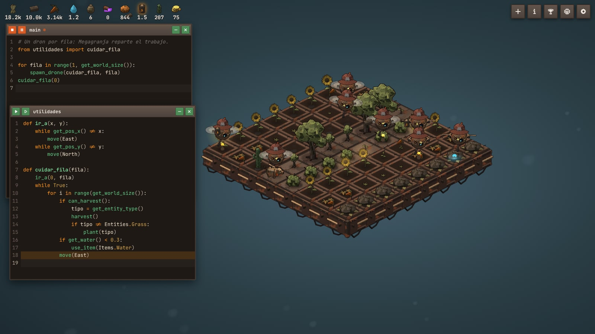
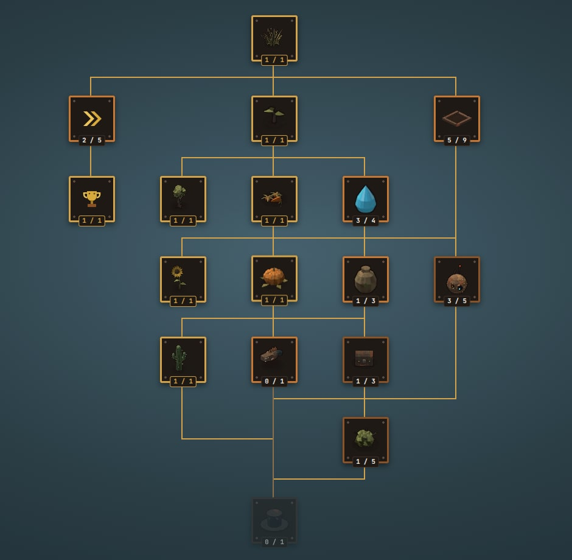
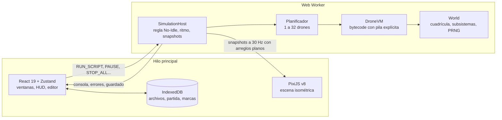

# FarmerCodex

**Juego web de automatización agrícola: programas una flota de drones con un lenguaje inspirado en Python 3 y los ves trabajar sobre una granja isométrica.**




FarmerCodex convierte la programación en el motor de una granja. No hay controles directos: cada siembra, cosecha o movimiento sale de un script que escribes en el propio juego. El código se compila a bytecode y se ejecuta en una máquina virtual propia dentro de un Web Worker, con un modelo de tiempo en ticks determinista, así que la misma partida con la misma semilla siempre produce el mismo resultado.

La estética combina chatarra retro-industrial (drones remachados, plataformas de hierro oxidado, terminales de código) con cultivos orgánicos de tonos apagados y postapocalípticos.

## Contenido

- [Características](#características)
- [El lenguaje](#el-lenguaje)
- [Primeros pasos](#primeros-pasos)
- [Controles](#controles)
- [Referencia de la API](#referencia-de-la-api)
- [Modelo de tiempo](#modelo-de-tiempo)
- [Arquitectura](#arquitectura)
- [Pruebas y calidad](#pruebas-y-calidad)
- [Documentación de diseño](#documentación-de-diseño)
- [Estado del proyecto](#estado-del-proyecto)

## Características

### Programación como mecánica central

- Subconjunto de Python 3 con funciones, recursión, cierres, listas, diccionarios, conjuntos, tuplas e `import` entre tus propios archivos.
- Compilador a bytecode y máquina virtual iterativa con pila explícita: un `while True:` nunca congela la interfaz y no se usa `eval()` ni `new Function()`.
- Ejecución paso a paso que se detiene en cada sentencia y entra en las funciones.
- Errores de sintaxis, de ejecución y de desbloqueo marcados en la línea exacta, al pie de la ventana del script.
- Editor CodeMirror 6 con resaltado, autocompletado de toda la API del juego y referencia integrada.

### Granja y subsistemas

- Granja expandible de 1×1 a 32×32 casillas (también rectangular, como 1×3) en 9 niveles de Expansión.
- 12 entidades y 11 recursos: pasto, arbustos, árboles, zanahorias, calabazas, girasoles y cactus, entre otros.
- Agua y fertilizante que se recargan solos según el nivel de su tecnología, con evaporación e infección.
- Seis subsistemas con reglas propias:
  - megacalabazas que se fusionan en bloques de N×N;
  - girasoles que producen energía (`Items.Power`) y duplican la velocidad de los drones;
  - cactus que solo rinden al máximo si la granja está ordenada;
  - laberintos generados con un cofre de oro;
  - policultivo con plantas compañeras;
  - modo Dinosaurio, con una cola que crece al comer manzanas.
- Árbol tecnológico de 17 nodos y 44 niveles, con costos y efectos definidos en JSON.

### Megagranja: hasta 32 drones

- `spawn_drone`, `wait_for`, `has_finished`, `num_drones` y `max_drones`, con un planificador Round-Robin.
- Cada dron hijo recibe una copia profunda de la función, sus variables globales, sus cierres y sus argumentos: ningún dron puede modificar la memoria de otro.

### Simulación, marcadores y progreso

- `simulate()` ejecuta un archivo en una granja aislada, con los desbloqueos, recursos, variables y semilla que elijas, y devuelve cuánto tiempo simulado tardó. Tu granja queda congelada mientras tanto.
- `set_world_size()` reduce la granja temporalmente para probar estrategias en un tablero pequeño.
- 16 marcadores locales con intentos cronometrados en granjas de semilla fija, medidos en ticks simulados.
- 59 logros con progreso visible y 18 sombreros para el dron, siete de ellos como recompensa de logros.

### Interfaz

- La granja ocupa toda la pantalla y el código vive en ventanas flotantes `.py`: se mueven, se redimensionan, se minimizan, se renombran y se cierran.
- La granja, los drones y el perro mascota son objetos independientes. Arrastrar mueve solo la granja. Un dron sin script flota donde quedó y, al ejecutar, vuela hasta su casilla. El dron y el perro también se pueden agarrar y soltar en otro sitio.
- HUD de inventario, árbol tecnológico a pantalla completa, ventana de logros y marcadores, y consola opcional con historial de 1000 líneas.
- Tres temas de editor, atajos de teclado y una barra de símbolos para pantallas táctiles.
- Efectos de sonido sintetizados con Web Audio y limitados a altas velocidades.
- Guardado automático en IndexedDB: los scripts, la partida y las marcas sobreviven entre sesiones.

### Renderizado

- PixiJS v8 con WebGL, en isometría 2:1 y a 60 FPS interpolados entre los estados del simulador.
- Todos los gráficos salen de un único atlas de sprites generado por código (`npm run assets`).
- Animaciones procedurales: brotes, cosechas, fusiones, piruetas y recursos que vuelan al HUD.
- Para rendir con 32 drones en 32×32: solo se redibujan las casillas que cambian, sprites y drones se reutilizan con pools, las partículas tienen un tope de 150 y el nivel de detalle baja solo según la carga.
- Si el atlas no carga, entra un renderizador low-poly de respaldo.



## El lenguaje

Un ejemplo con dos archivos. `utilidades.py` define cómo cuidar una fila:

```python
def ir_a(x, y):
    while get_pos_x() != x:
        move(East)
    while get_pos_y() != y:
        move(North)

def cuidar_fila(fila):
    ir_a(0, fila)
    while True:
        for i in range(get_world_size()):
            if can_harvest():
                tipo = get_entity_type()
                harvest()
                if tipo != Entities.Grass:
                    plant(tipo)
            if get_water() < 0.3:
                use_item(Items.Water)
            move(East)
```

`main.py` reparte el trabajo entre los drones, uno por fila:

```python
from utilidades import cuidar_fila

for fila in range(1, get_world_size()):
    spawn_drone(cuidar_fila, fila)
cuidar_fila(0)
```

Y `simulate()` permite medir una estrategia sin tocar la partida:

```python
segundos = simulate("estrategia.py", Unlocks, {Items.Carrot: 500}, {"objetivo": 100}, 7, 16)
quick_print("La estrategia tardó", segundos, "segundos simulados")
```

**Incluido:**
- `int`, `float`, `bool`, `None`, `str`, `list`, `tuple`, `dict` y `set`.
- Operadores aritméticos, comparaciones encadenadas, `and`/`or`/`not`, `in` e `is`.
- `if`/`elif`/`else`, `while`, `for ... in`, `break`, `continue` y `pass`.
- `def` con valores por defecto, argumentos con nombre, recursión, cierres y funciones como valores.
- `global`, anotaciones de tipo (se ignoran) e `import nombre`, `from nombre import f` y `from nombre import *`.

**No incluido:** `lambda`, clases, `try`, comprensiones y f-strings.

## Primeros pasos

### Requisitos

- Node.js 22 o superior (probado con 22.22) y npm 9 o superior.
- Un navegador moderno con WebGL, Web Workers e IndexedDB.

### Instalación

```bash
npm install
```

```bash
npm run dev
```

La aplicación queda disponible en `http://localhost:5173`.

### Scripts disponibles

| Comando | Descripción |
| :--- | :--- |
| `npm run dev` | Servidor de desarrollo de Vite con recarga en caliente. |
| `npm run build` | Comprobación de tipos y build de producción en `dist/`. |
| `npm run preview` | Sirve el build de producción para revisarlo. |
| `npm test` | Ejecuta todas las pruebas con Vitest. |
| `npm run typecheck` | Comprueba los tipos de la aplicación, del motor sin DOM y de las pruebas. |
| `npm run assets` | Regenera los sprites (`assets-src/sprites`) y el atlas (`public/assets`). Tarda unos 2 minutos. |
| `npm run atlas` | Solo vuelve a empaquetar el atlas a partir de los PNG existentes. |

## Controles

| Acción | Control |
| :--- | :--- |
| Ejecutar, pausar o continuar el script activo | `Ctrl+Enter` |
| Avanzar una sentencia (paso a paso) | `F10` |
| Detener la ejecución | `Ctrl+Shift+Enter` |
| Mostrar u ocultar la interfaz | `F1` o `H` |
| Árbol tecnológico | `T` |
| Logros y marcadores | `L` |
| Cerrar ajustes, árbol o ventana auxiliar | `Esc` |
| Mover la granja | Arrastrar sobre ella |
| Mover el dron o el perro | Arrastrarlos |
| Zoom | Rueda del ratón o pellizco |
| Recentrar la vista | Doble clic |
| Renombrar un archivo | Doble clic en el nombre de su ventana |

Cada ventana de código tiene en su barra de título los botones Ejecutar y Paso a paso, que pasan a Detener y Pausar mientras el script corre.

## Referencia de la API

El botón **i** del juego abre la referencia completa, con el costo de cada función.

| Categoría | Funciones |
| :--- | :--- |
| Acciones | `move`, `harvest`, `till`, `plant`, `use_item`, `swap`, `change_hat`, `pet_the_dog` (alias `pet_the_piggy`), `do_a_flip`, `clear` |
| Sensores | `can_harvest`, `can_move`, `measure`, `get_companion`, `get_pos_x`, `get_pos_y`, `get_world_size`, `get_entity_type`, `get_ground_type`, `get_water` |
| Progreso | `num_items`, `unlock`, `num_unlocked`, `get_cost` |
| Megagranja | `spawn_drone`, `wait_for`, `has_finished`, `num_drones`, `max_drones` |
| Simulación | `simulate`, `set_world_size`, `set_execution_speed`, `leaderboard_run`, `get_time`, `get_tick_count` |
| Salida | `print` (texto flotante sobre el dron), `quick_print` (consola) |
| Utilidades | `len`, `range`, `abs`, `min`, `max`, `random`, `str`, `int`, `float`, `bool`, `list`, `tuple`, `set`, `dict` |
| Enums | `Items`, `Entities`, `Grounds`, `Directions` (`North`, `East`, `South`, `West`), `Unlocks`, `Hats`, `Leaderboards` |

Las funciones de una tecnología que aún no se ha desbloqueado detienen el script con un `UnlockError` que indica qué nodo del árbol hace falta.

## Modelo de tiempo

| Operación | Costo |
| :--- | :--- |
| Asignaciones y literales | 0 ticks |
| Aritmética, comparaciones, lógica, subíndices y llamadas | 1 tick |
| Cada vuelta de bucle | 1 tick |
| Acciones físicas (`move`, `harvest`, `plant`, `till`...) | 200 ticks; 1 si fallan |
| `do_a_flip()` | 1 segundo real fijo |

- **Ritmo base:** 400 ticks por segundo real. La tecnología Velocidad lo multiplica hasta ×6.
- **Energía:** con `Items.Power`, cada dron trabaja al doble de velocidad mientras haya energía.
- **Regla No-Idle:** el tiempo simulado, el crecimiento de las plantas y la evaporación solo avanzan mientras algún dron ejecuta código. Con todo detenido o en pausa, el mundo se congela.
- **Inicio:** cada ejecución empieza con el dron principal en la casilla (0, 0).

## Arquitectura



| Carpeta | Contenido |
| :--- | :--- |
| `src/config/` | `balance.json`, `techTree.json`, `achievements.json` y `leaderboards.json`. Ninguna cifra de balance está escrita en el código. |
| `src/engine/` | Mundo determinista en TypeScript puro y sin DOM: PRNG Mulberry32, cuadrícula, inventario, tecnologías, logros, marcadores y los seis subsistemas. |
| `src/vm/` | Lexer con `INDENT`/`DEDENT`, parser, compilador a bytecode, máquina virtual, builtins, planificador y flota de drones aislados. |
| `src/worker/` | Protocolo de mensajes tipado, `SimulationHost` (marcadores y simulaciones en granjas aisladas) y punto de entrada del Worker. |
| `src/renderer/` | Escena PixiJS: `IsoStage` con sprites del atlas, granja y voladores en capas independientes, partículas y nivel de detalle automático; renderizador low-poly de respaldo. |
| `src/ui/` | Componentes React: ventanas flotantes, HUD, editor, árbol tecnológico y registros. |
| `src/store/` | Estado con Zustand, arranque, guardado y cliente del Worker. |
| `src/persistence/` | Acceso a IndexedDB (`farmercodex_db`) con `idb`. |
| `src/audio/` | Efectos sintetizados con Web Audio y su limitador. |
| `scripts/` | Generación de sprites isométricos y empaquetado del atlas. |
| `tests/` | Pruebas Vitest del lenguaje, el motor, los subsistemas, la simulación y el renderizado. |

### Principios de diseño

1. **Aislamiento:** el intérprete y el motor nunca corren en el hilo principal. La interfaz sigue fluida aunque un script entre en un bucle infinito.
2. **Sin evaluación dinámica:** el código del jugador solo se ejecuta en la máquina virtual propia.
3. **Determinismo estricto:** toda la aleatoriedad del motor sale de un PRNG con semilla. `Math.random()` está prohibido en `src/engine/` y `src/vm/`.
4. **Motor portable:** `src/engine/` y `src/vm/` compilan sin la librería DOM (`tsconfig.engine.json`) y corren directamente en Node.
5. **Datos antes que código:** costos, crecimiento, rendimientos y desbloqueos se leen de los archivos de configuración.

`tests/rules.test.ts` impide que estas reglas se rompan: falla si aparecen `Math.random`, `eval`, `new Function`, APIs del DOM o tiempo real dentro del motor.

## Pruebas y calidad

El proyecto tiene 458 pruebas deterministas en 28 archivos. Cubren:

- el lexer, el parser, el compilador y la máquina virtual, incluido el costo exacto en ticks de cada operación;
- las fórmulas y reglas de cada subsistema, que se leen de `balance.json`;
- la regla No-Idle, el host de simulación, el guardado y la carga;
- el aislamiento de memoria entre drones y una prueba de estrés de 100 000 ticks con 32 drones;
- logros, marcadores, `simulate()` y `set_world_size()`;
- la proyección isométrica, el nivel de detalle, el contrato del atlas y el vuelo libre de los drones.

```bash
npm test
```

```bash
npm run typecheck
```

## Documentación de diseño

La carpeta [`docs/`](docs) contiene la especificación completa:

| Documento | Tema |
| :--- | :--- |
| [01 Arquitectura](docs/01_ARCHITECTURE.md) | Puente con el Worker, ticks, PRNG, renderizado y persistencia |
| [02 Lenguaje y VM](docs/02_DSL_AND_VM_SPEC.md) | Gramática, AST, máquina virtual, Megagranja y API |
| [03 Mecánicas y datos](docs/03_GAME_MECHANICS_AND_DATA.md) | Cuadrícula, entidades, subsistemas, balance y árbol tecnológico |
| [04 Hoja de ruta](docs/04_IMPLEMENTATION_ROADMAP.md) | Fases de implementación y decisiones tomadas |
| [05 Estilo visual](docs/05_VISUAL_STYLE_AND_PALETTE.md) | Dirección de arte, paleta y capas 2.5D |
| [06 Assets](docs/06_ASSETS_AND_ENTITY_SHAPES.md) | Catálogo de sprites y pipeline del atlas |
| [07 Interfaz](docs/07_UI_UX_AND_TECH_TREE_DESIGN.md) | Ventanas flotantes, HUD y árbol tecnológico |
| [08 Animaciones](docs/08_ANIMATIONS_SPEC.md) | Animaciones procedurales, partículas y nivel de detalle |

[`AGENTS.md`](AGENTS.md) resume las reglas obligatorias para quien contribuya al código.

## Estado del proyecto

Las cuatro fases de la hoja de ruta están completas:

1. Núcleo determinista, intérprete, Web Worker e interfaz.
2. Cultivos, agua, fertilizante, árbol tecnológico, imports y guardado.
3. Los seis subsistemas.
4. Megagranja, logros, marcadores y pulido de interfaz.

Después se añadieron `simulate()`, `set_world_size()` y la granja independiente del dron y del perro.

Pendiente: el bloqueo progresivo de la sintaxis del lenguaje según el árbol tecnológico.
